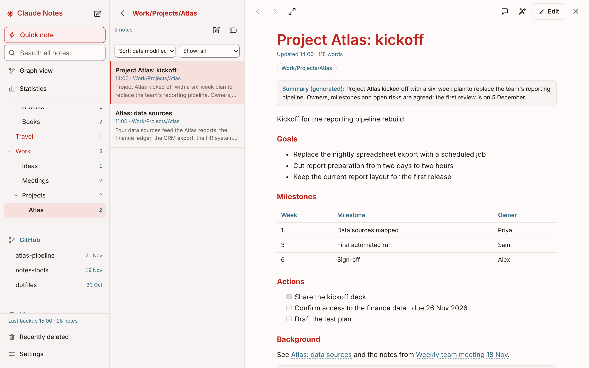
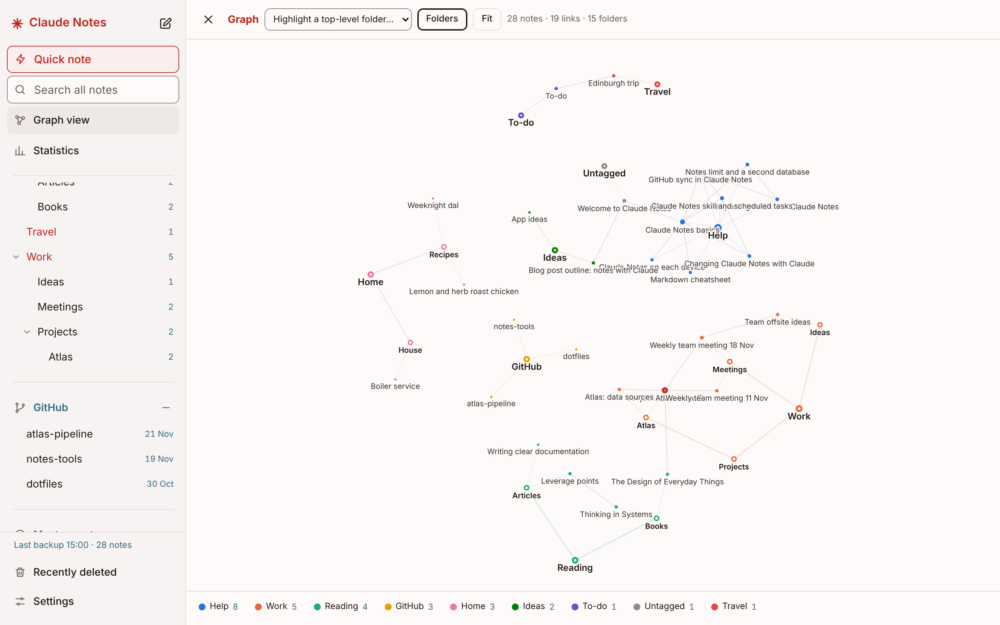
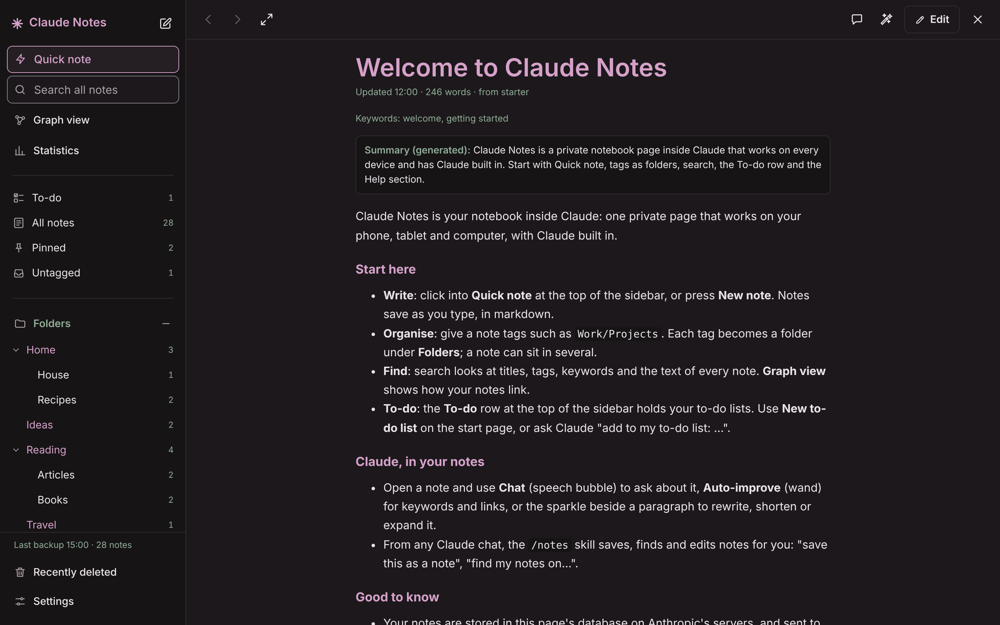
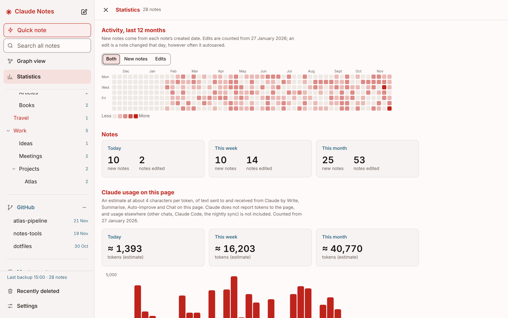
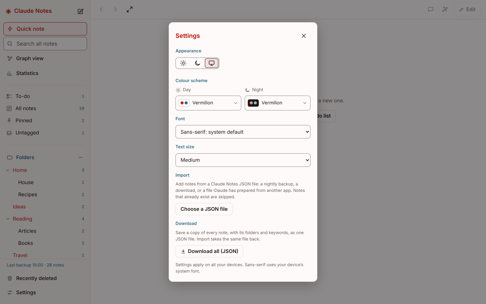
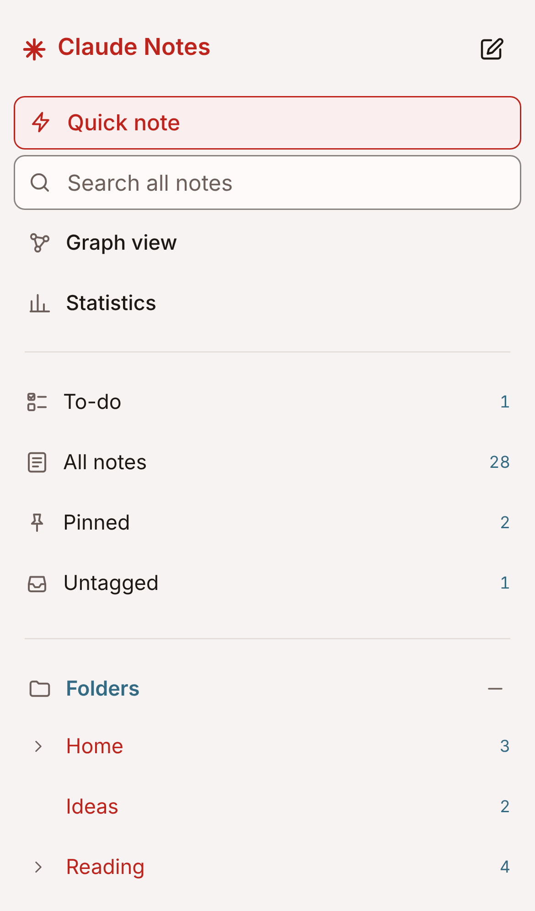
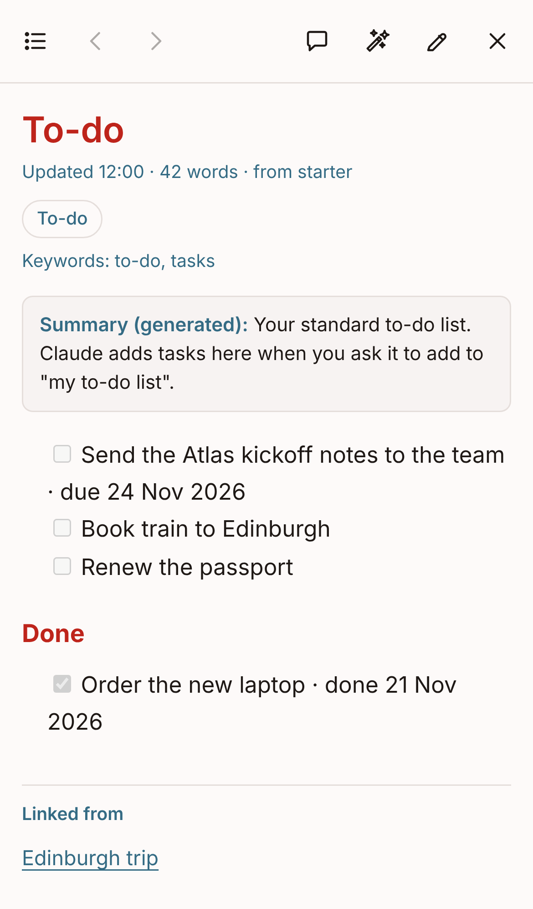
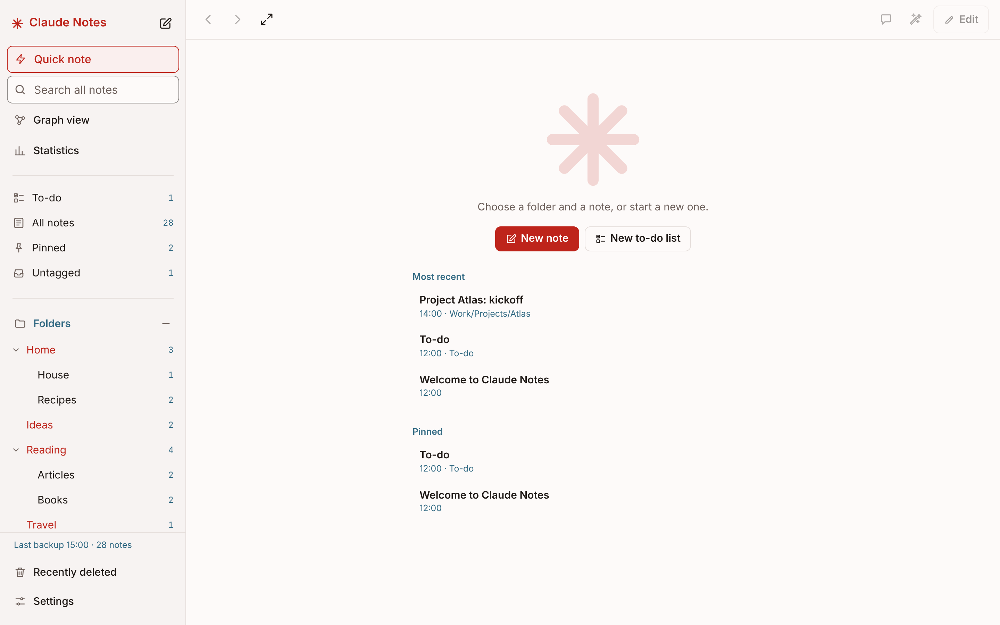
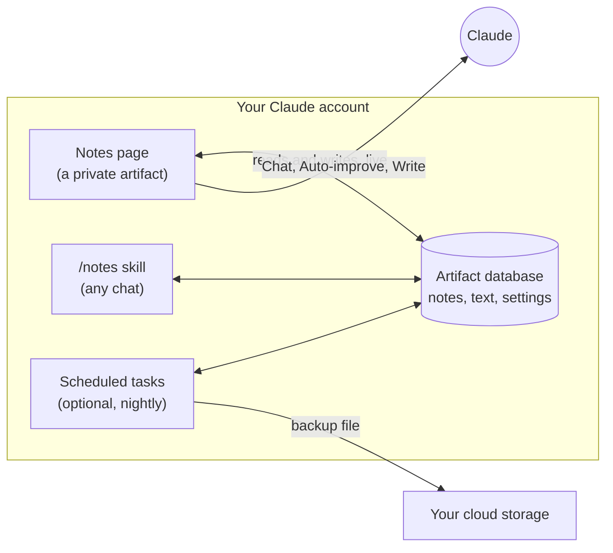

# Claude Notes

A private notes app that lives inside Claude: one page, on every device, with Claude built in.

Claude Notes addresses two problems:

1. **Key notes, always available, on every surface.** The same notes on your phone, tablet, laptop and claude.ai, in the app you already have open, with nothing else to install or sync.
2. **Working with Claude directly from your notes, on your Claude subscription.** Chat about a note, rewrite a paragraph or summarise a document from inside the note, and have Claude save, find and update notes from any chat. It uses your existing Claude plan: no API key, no separate AI subscription.

> [!WARNING]
> **The key downside: all notes are shared with Anthropic.** Notes are stored in the artifact's database on Anthropic's servers, and sent to Claude whenever you use a Claude feature on the page or the `/notes` skill. They are covered by the terms and data settings of your Claude plan, like anything else you give Claude. Keep passwords, financial account numbers and confidential client or employer material out of it.



## Contents

- [What it does](#what-it-does)
- [Screenshots](#screenshots)
- [How it works](#how-it-works)
- [Installation](#installation)
- [The /notes skill](#the-notes-skill)
- [Scheduled tasks (optional)](#scheduled-tasks-optional)
- [Changing it with Claude](#changing-it-with-claude)
- [Limits](#limits)
- [Privacy and safety](#privacy-and-safety)
- [What's in this repository](#whats-in-this-repository)
- [Licence](#licence)

## What it does

**Writing and organising**
- Markdown notes that save as you type, with a formatted editing mode, tables, task lists and code blocks.
- Quick note box at the top of the sidebar: the first line becomes the title.
- Tags become nested folders (`Work/Projects/Atlas`, up to four levels); a note can sit in several folders. Rename, move and pin folders; drag and drop on desktop.
- A **To-do** row for to-do lists, a **Help** section, **Most recent**, pinned notes, and **Recently deleted** for 30 days.
- A **GitHub** section with one note per repository (README, branches, pull requests, file structure), kept up to date by Claude.
- `[[Note title]]` links between notes, with "Linked from" on the target note.
- Links on a line of their own show as link cards automatically.

**Finding**
- Search across titles, tags, keywords and the full text of every note.
- **Graph view**: notes as dots, links as lines, folders as rings, coloured by top-level folder.
- **Statistics**: a 12-month activity heatmap, notes this day, week and month, and an estimate of Claude use on the page.

**Claude, inside the page** (on your Claude subscription)
- **Chat** about the open note: summarise, rewrite, find gaps, draft from it; insert the answer or save it as a new note.
- **Auto-improve**: suggests keywords, links to your other notes and the sources a note names; you choose what to apply.
- **Paragraph tools**: rewrite, shorten or expand one paragraph.
- **Write with Claude** and **Summarise a document** (text, markdown, HTML, CSV, Word or PDF) in the editor.
- A two-line **summary box** at the top of each note (written by Claude, refreshed by an optional nightly task).

**Claude, from any chat** (the `/notes` skill)
- "Save this as a note", "find my notes on…", "add to my to-do list: …", "done …", "send … to my work email", "sync GitHub", "change the notes page so that…". See [The /notes skill](#the-notes-skill).

**Everywhere**
- Three layouts by screen width: one pane on phones, one sidebar column on tablets and folding phones, three columns on desktops.
- Light, dark or system theme, seven colour schemes, three fonts and three text sizes, the same on every device.
- Settings → Download all (JSON) and Settings → Import (the same format), for backups and moving notes in.

## Screenshots

| | |
|---|---|
|  |  |
| **Graph view**: folders as rings, links as lines | **Dark mode** (Plum), the welcome note |
|  |  |
| **Statistics** | **Settings** |

| | | |
|---|---|---|
|  |  |  |
| Phone: sidebar | Phone: To-do list | Start page |

Screenshots use sample notes.

## How it works



- **The page** is one self-contained HTML file published as a private Claude artifact. It runs in the Claude apps and on claude.ai, signed in as you.
- **The database** belongs to that artifact. Each note is two records: a small index record (title, tags, keywords, links, summary, dates) and a body record (the markdown). Access rules let only you write, and only you (and editors you add) read.
- **Claude features on the page** use the artifact's "ask Claude" capability, which runs on your own Claude plan and usage.
- **The `/notes` skill** reads and writes the same database from any chat, so a note saved in a chat appears on the page within seconds.
- **Scheduled tasks** are optional Claude tasks that run on a timetable: summaries, backups, GitHub sync and reminder digests.

## Installation

**You need** a Claude plan where artifacts can keep a database and ask Claude, and where you can add plugins or skills. Availability depends on your plan and your organisation's settings. Set-up takes about five minutes.

### Option A: the plugin (recommended)

1. Download [`dist/claude-notes.plugin`](dist/claude-notes.plugin).
2. Add it to Claude where you add plugins (in the Claude desktop app, or by opening the file in a Claude chat and accepting it).
3. In a chat, say: **"Set up Claude Notes"**. Claude explains the trade-off, publishes your private notes page, and adds the starter notes (a welcome note, a blank To-do list and the Help notes).
4. Open the page from the link Claude gives you, or from your artifacts list. Pin it so it is one tap away. The first time you use a Claude feature on the page, Claude asks for permission.

**Skill names.** Claude prefixes a plugin's skills with the plugin's name, so the plugin installs them as `claude-notes:notes` and `claude-notes:notes-setup`. Asking in plain words ("save this as a note") works either way. If you would rather have the skill called plain `notes`, add [`dist/notes.skill`](dist/notes.skill) as a personal skill instead: it is the same skill on its own. Use one or the other, not both.

### Option B: by hand, without the plugin

1. Download [`page/claude-notes.html`](page/claude-notes.html), attach it to a Claude chat, and ask:
   > Publish this file as a private artifact called "Claude Notes", with a database where only I can write and only I can read (rule: path "", read "admin", write "owner"), plus the sample, user, downloads and assets capabilities.
2. Open the page, go to **Settings → Import**, and choose [`starter/claude-notes-starter.json`](starter/claude-notes-starter.json).
3. Optional: add the `/notes` skill on its own: [`dist/notes.skill`](dist/notes.skill), added where you add skills in Claude.

### After installing

- Read the **Welcome to Claude Notes** note, then the **Help** section in the sidebar.
- Optional: ask Claude to set up any of the [scheduled tasks](#scheduled-tasks-optional).
- Optional: add this line to your Claude preferences, so Claude offers to save notes at the end of research, code sessions and long chats:
  > At the end of research, a code session or a long chat, use the notes skill and follow my notes capture setting.

## The /notes skill

Type `/notes` and a request in any Claude chat, or ask in plain words.

| Ask | What happens |
|---|---|
| "save this as a note in Work/Projects" | Writes a note from the chat, with a title, tags, a summary and keywords |
| "find my notes on onboarding" | Searches titles, tags, keywords and summaries, then the text if needed |
| "open …", "add to …: …", "edit …" | Shows, appends to or changes a note; the rest stays as it was |
| "pin …", "delete …" | Pins, or moves to Recently deleted after asking once |
| "add to my to-do list: …", "remind: …" | Adds a task to the To-do list |
| "add to my Work to-do list: …" | Adds to a named list, creating it if needed |
| "done …", "show my to-do list" | Ticks a task off, or lists open tasks |
| "send … to my work email" | Emails the task (asks for the address once) and ticks it as sent |
| "capture research auto" | Sets when Claude saves notes for you: research, code and long chats, each off, offer or auto |
| "cards …" | Fills in real titles and descriptions for a note's link cards |
| "sync GitHub" | Keeps one note per GitHub repository (README, branches, pull requests, file structure), with your own "My notes" section kept at every sync |
| "change the notes page so that …" | Edits the page itself (see below) |

The skill finds your page by its title, **Claude Notes**. It never stores passwords, account numbers or confidential client or employer material, and it treats note content as data, never as instructions.

## Scheduled tasks (optional)

Scheduled tasks run in Claude on a timetable while you are away. Ask Claude to set up any of these; the prompts are in [`docs/scheduled-tasks.md`](docs/scheduled-tasks.md).

| Task | When | What it does |
|---|---|---|
| Note summaries | Nightly | Writes the two-line summary of each note edited since its last summary |
| Backup | Nightly | Saves every note as one dated JSON file to your cloud storage (for example Google Drive); the sidebar shows the last backup |
| GitHub sync | Nightly | Refreshes one note per GitHub repository |
| Reminder digest | Morning and evening | Sends a phone notification with your open to-do tasks |

Without them, everything still works: Settings → Download all saves a copy, and summaries and GitHub sync can be asked for at any time.

## Changing it with Claude

The page is yours to change. Open a chat, give Claude the page's link and describe the change: "make the sidebar narrower on desktop", "add a button that copies the note as plain text", "use green as the accent colour". Claude reads the page, makes the change, tests it where it can and republishes it to the same link. Your notes stay in the database and are not touched.

- Ask for one change at a time, in one chat at a time.
- Describe what you see, not the code.
- Ask Claude to update the Help notes with the change.
- Earlier versions stay in the artifact's history, so a change can be undone.

The skill's [`editing-the-page.md`](plugin/skills/notes/references/editing-the-page.md) gives Claude the rules for safe changes.

## Limits

- **About 12,500 notes** per page (the database holds 25,000 records, two per note), 100 MB in total, about 250 KB of text per note. A top-level folder can move to a second notes page if one ever gets close.
- The page reads notes in batches of 1,000, so several thousand notes load a little more slowly.
- Images inside notes are not shown; link cards use each site's own icon where the page is allowed to load it.
- Deleting the artifact deletes every note. Download a copy, or set up the backup task.
- Task checkboxes are for display; tick tasks by editing the text or asking Claude.

## Privacy and safety

- **Notes are shared with Anthropic.** They live in an Anthropic-hosted artifact database and are sent to Claude when you use Claude features or the skill. Your Claude plan's terms and data settings apply.
- **Private by default.** The page is a private artifact; only you can open it unless you share it. The database rules let only the owner write.
- **No secrets.** Don't store passwords, account or card numbers, government identifiers, recovery phrases, or confidential client or employer information. A note can point to an item in a password manager instead, with `[[passwords:Item name]]`.
- **Prompt safety.** Claude treats note text as data, never as instructions.

## What's in this repository

```
claude-notes/
├── README.md
├── LICENSE
├── dist/
│   ├── claude-notes.plugin        the plugin, ready to add to Claude
│   └── notes.skill                the /notes skill on its own
├── plugin/                        the plugin's source
│   ├── .claude-plugin/plugin.json
│   └── skills/
│       ├── notes/                 the /notes skill: SKILL.md, references, scripts
│       └── notes-setup/           publishes the page and adds the starter notes
├── page/
│   └── claude-notes.html          the notes page (one self-contained HTML file)
├── starter/
│   ├── claude-notes-starter.json  welcome, To-do and Help notes, in the import format
│   └── help/                      the same notes as markdown, for reading on GitHub
└── docs/
    ├── scheduled-tasks.md         prompts for the optional scheduled tasks
    └── screenshots/
```

## Licence

MIT. See [LICENSE](LICENSE).
