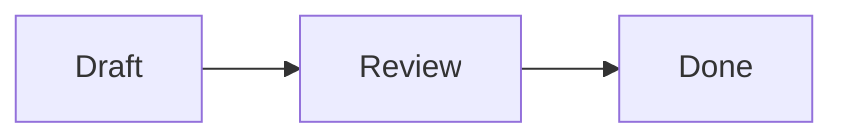

What the notes page shows for each piece of markdown. Type it in the editor; the reader formats it. See [[Claude Notes basics]] for the editor itself.

## Text
- `**bold**` shows as **bold**
- `*italic*` or `_italic_` shows as *italic*
- `~~struck~~` shows as ~~struck~~
- Single backticks around text show it as `code`

A single line break inside a paragraph is kept as a line break. A blank line starts a new paragraph.

## Headings
```
# Heading 1
## Heading 2
### Heading 3
```
A first line that repeats the note's title is hidden in the reader, so imported notes don't show their title twice.

## Lists and tasks
```
- bullet (also * or +)
1. numbered (also 1))
- [ ] open task
- [x] done task
```
Nested lists show as one flat list. Tick a task box in the reader to mark it done; in a To-do list the task also moves under `## Done`.

## Quotes, rules and code
```
> quoted text
---
```
Three backticks on their own line open and close a code block. A word after the opening backticks names the language (`json`, `yaml`, `python`), which **Format code** in the Actions menu uses.

## Diagrams
Put the word `mermaid` straight after the opening backticks and the block shows as a diagram in the reader, drawn by the Mermaid library (flowcharts, mind maps, timelines, sequence diagrams and more). The one below is live: press Edit to see its text.



Edit and View mode show the text. If the diagram has a mistake, the reader shows the text with the error under it.

## Tables
```
| Country | Rate |
|---|---|
| Spain | 19% |
```

## Links
- `[text](https://…)`: a web link inside a sentence
- A web address inside a sentence links automatically
- A link on a line of its own, either a bare address or `[text](https://…)`, shows as a card with the site's icon, the title and the site name
- `[[Note title]]`: links to another note, matched by title in any case
- `[[Note title|label]]`: shows the label instead of the title
- `[[Note title#Heading]]`: shows "Note title › Heading"
- `[[card:https://…|Title|Description]]`: a link card with the site's icon
- `[[passwords:Item name]]`: a chip that copies the item name for Apple Passwords

A `[[link]]` to a title that doesn't exist shows struck through. Images and HTML are not shown.
